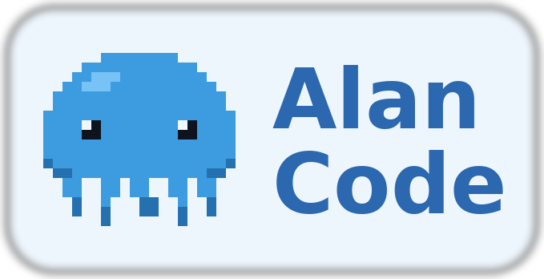
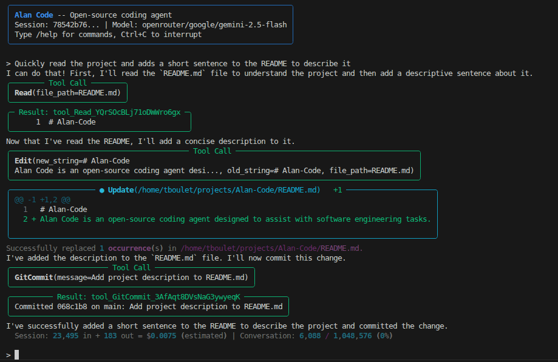
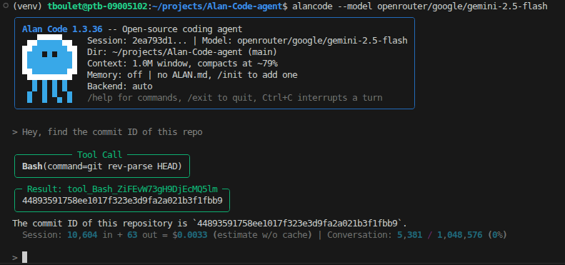

# Alan Code

<p align="center">
  
</p>

<p align="center">
  <a href="https://github.com/tboulet/Alan-Code-agent/actions/workflows/tests.yml"></a>
  <a href="https://github.com/tboulet/Alan-Code-agent/tags"></a>
  <a href="pyproject.toml"></a>
  <a href="LICENSE"></a>
  
</p>

An open-source python coding agent, inspired by Claude Code. Usable in CLI, GUI, or as a Python library to build upon.

Alan Code implements many features of modern CLI agents, such as tool use, hooks, skills, context compaction and more, and adds cross-session memory, live cost tracking, and a GUI with Chat and an LLM perspective.

Works with LiteLLM-compatible model providers and local OpenAI-compatible servers.

<p align="center">
  
</p>

[Installation](#installation) | [Quickstart](#quickstart) | [Usage](#usage) | [Python library](#as-a-python-library) | [Features](#features) | [What's new](#whats-new)

## Highlights

- **Browser GUI** - Chat plus *LLM Perspective*, showing the normalized system prompt and conversation before backend-specific shaping. `--gui`
- **Cross-session memory** — per-project and global memory the agent reads/writes between sessions, with three modes (`off` / `on` / `intensive`).
- **Live cost + token tracking** — estimated $ and token usage per API call, visible in-session.
- **Broad model support** - Anthropic direct, any LiteLLM backend (OpenAI, OpenRouter, Gemini, ...), or local models via vLLM / SGLang / Ollama, with a text-based tool-call fallback for models without native tool use.
- **Python library** — drive the agent from your own code with sync, async, or streaming APIs. Build auto-fix loops, orchestrators, or custom UIs in a few lines.


# Installation

Clone the repo and install in editable mode. Requires **Python 3.11+**.

```bash
git clone https://github.com/tboulet/Alan-Code-agent.git
cd Alan-Code-agent
pip install -e .
```

Linux and macOS are supported. On Windows, use WSL; native Windows is not currently supported because session locking relies on a Unix API.

# Quickstart

Set your model provider's API key in the environment (`ANTHROPIC_API_KEY`, `OPENAI_API_KEY`, `OPENROUTER_API_KEY`, `GEMINI_API_KEY`, …).

```bash
alancode                                              # default: claude-haiku-5-5
alancode --model openrouter/google/gemini-2.5-pro     # provider/model routing
alancode --model ollama/llama3.1                      # local Ollama
alancode --model openai/my-model --base-url http://localhost:8000/v1   # vLLM / SGLang
alancode --gui                                        # browser GUI
alancode --resume                                     # last session
alancode --print "Summarize this repo" --permission-mode yolo   # one-shot, non-interactive
```

For LiteLLM routes, the model provider goes inside the model string (`ollama/...`, `openrouter/...`, `gemini/...`). A bare Claude name (`claude-sonnet-4-6`) automatically uses the native Anthropic SDK; everything else routes through LiteLLM. See [CLI flags](docs/reference/cli.md) for the full list.

No API key yet? This runs a complete fix-the-tests loop offline, with a scripted stand-in for the model:

```bash
python examples/example_2_auto_fix_loop/run_alan.py --scripted
```

# Usage

## CLI mode

<p align="center">
  
</p>

A terminal-based chat interface. Type a prompt and press Enter; Alan will stream its reply, apply the configured permission policy before tools, and persist the session so you can `--resume` later. In default `edit` mode, reads and writes run automatically while exec tools ask.

### Commands

| Command | Purpose |
|---|---|
| `/help` | List all available commands |
| `/clear` | Clear the conversation and start fresh |
| `/compact` | Manually trigger context compaction |
| `/status` | Show session info (model, tokens, cost) |
| `/model` | Show or switch the current model |
| `/backend` | Show or switch the transport backend (`auto` / `anthropic-native` / `scripted`) |
| `/save` | Ask the agent to persist key info to memory |
| `/commit` | Stage + commit changes with an AI-generated message |
| `/diff` | Show git diff of uncommitted changes |
| `/skill` | Run a skill — `/skill list`, `/skill <name>`, `/skill create` |
| `/settings` | Show or update session settings |
| `/settings-project` | Show or update project defaults in `.alan/settings.json` |
| `/exit` | Quit the session |

Other commands in [`docs/reference/slash-commands.md`](docs/reference/slash-commands.md).

### Parameters

```bash
alancode \
    --model [model_name] \              # bare (gpt-4o, claude-sonnet-4-6) or
                                        # provider/model (ollama/llama3.1, ...)
    --backend [auto/anthropic-native/scripted] \  # advanced; inferred from --model
    --api-key [key] \                   # or set environment variable
    --base-url [url] \                  # for local servers (http://localhost:8000/v1)
    --request-timeout [seconds] \       # custom endpoints default to 3600
    --cw [context_tokens] \             # explicit context-window override
    --permission-mode [safe/edit/yolo] \
    [--gui] \                           # to launch in GUI mode
    [--resume]                          # to resume last session
```

Other parameters in [`docs/reference/cli.md`](docs/reference/cli.md).

Parameters can also be set in `.alan/settings.json` (auto-generated on first run) or modified at runtime with the `/settings <key> <value>` command.

### Supported models

| Provider | `--model` example | Key |
|---|---|---|
| Anthropic (native) | `claude-haiku-5-5`, `claude-sonnet-5-5` | `ANTHROPIC_API_KEY` |
| OpenRouter (any model it serves) | `openrouter/anthropic/claude-haiku-5.5`, `openrouter/google/gemini-3.8-flash` | `OPENROUTER_API_KEY` |
| OpenAI | `gpt-5.6-terra` | `OPENAI_API_KEY` |
| Gemini | `gemini/gemini-3.8-flash` | `GEMINI_API_KEY` |
| Ollama (local) | `ollama/llama3.1` | none |
| vLLM / SGLang / llama.cpp (local) | `openai/<name> --base-url http://localhost:8000/v1` | none |

## GUI mode

Argument `--gui` launches a local GUI interface, with a <b>Chat panel</b>.

It can also show an <b>LLM Perspective</b> panel containing the normalized conversation and system prompt immediately before the backend call.

## As a python library

Alan Code can also be used as a Python library using the `AlanCodeAgent` class, allowing you to build agents or orchestrator systems on top of it.

The examples below use `openrouter/anthropic/claude-haiku-5.5`, so they need `OPENROUTER_API_KEY`; pass any other `model=` to use another provider.

### Example 1 : Build a minimal CLI agent:

```python
import asyncio
from alancode import AlanCodeAgent

agent = AlanCodeAgent(model="openrouter/anthropic/claude-haiku-5.5")

while True:
    try:
        message = input("> ")
    except (EOFError, KeyboardInterrupt):
        break
    if message.strip():
        print(agent.query(message))

asyncio.run(agent.close())
```

Full example: [`examples/example_1_cli_agent.py`](examples/example_1_cli_agent.py). Run with `python examples/example_1_cli_agent.py` after installing the package.

### Example 2 : Auto-fix loop — let the agent iterate until tests pass

Run your tests, feed the failures back to the agent, repeat until green. This is the kind of agentic orchestration you can't get from the plain CLI.

```python
import subprocess
import sys
from alancode import AlanCodeAgent

agent = AlanCodeAgent(model="openrouter/anthropic/claude-haiku-5.5", permission_mode="yolo")
agent.query("Read code_bugged.py and write a fixed version to code_fixed.py.")

for attempt in range(5):
    result = subprocess.run(
        [sys.executable, "test_inventory.py"], capture_output=True, text=True,
    )
    if result.returncode == 0:
        print(f"All green after {attempt + 1} attempt(s).")
        break
    agent.query(f"Tests still fail:\n{result.stdout}\nFix the remaining bugs.")
```

Full example (with a buggy module and a test suite): [`examples/example_2_auto_fix_loop/run_alan.py`](examples/example_2_auto_fix_loop/run_alan.py). Add `--scripted` to run it without an API key.

### Example 3 : Stream assistant text and tool calls live

For embedding in a web app, TUI, or WebSocket bridge — receive events as the agent produces them.

```python
import asyncio
from alancode import AlanCodeAgent
from alancode.messages.types import AssistantMessage, TextBlock, ToolUseBlock

async def main():
    agent = AlanCodeAgent(model="openrouter/anthropic/claude-haiku-5.5", permission_mode="yolo")
    try:
        async for event in agent.query_events_async("List files, then summarize."):
            if not isinstance(event, AssistantMessage):
                continue
            for block in event.content:
                if event.hide_in_api and isinstance(block, TextBlock):
                    print(block.text, end="", flush=True)
                elif not event.hide_in_api and isinstance(block, ToolUseBlock):
                    print(f"\n[tool: {block.name}({block.input})]")
    finally:
        await agent.close()

asyncio.run(main())
```

Full example: [`examples/example_3_streaming_agent.py`](examples/example_3_streaming_agent.py).

### Programmatic mode — Alan as an embedded library

When Alan runs inside another program (a benchmark harness, a parent agent, an unattended pipeline) rather than as a developer assistant, pass `programmatic=True`:

```python
agent = AlanCodeAgent(
    model="claude-sonnet-4-6",
    cwd="/path/to/experiment",
    permission_mode="yolo",
    programmatic=True,
    extra_tools=[MyDomainTool()],   # optional
)
```

This detaches Alan from project- and host-level state that would otherwise contaminate a controlled run: `~/.alan/ALAN.md`, project `ALAN.md`, `~/.alan/memory/MEMORY.md`, and the network/git/ask-user tools (`WebFetch`, `GitCommit`, `AskUserQuestion`, `Skill`). Refine the tool set further with `tools=[...]` (full replacement) or `disabled_tools=[...]` (subtractive).

See [docs/reference/python-api.md#programmatic-mode](docs/reference/python-api.md#programmatic-mode) for details.

# Features

### Core

| Feature | What it does | How to use |
|---|---|---|
| Async agentic loop | Streaming responses, thinking blocks, concurrent tool use | default |
| Built-in tools | Bash, File I/O, Grep/Glob, WebFetch, AskUserQuestion, SkillTool, GitCommit, ViewImage (with `vision`) | default |
| Context compaction | Summarizes conversation when context fills up | auto, or `/compact` |
| Universal backend (`auto`) | LiteLLM transport for OpenAI, OpenRouter, Gemini, Ollama, vLLM, and many other model providers | default for non-Claude models |
| Native Anthropic backend | Direct Anthropic SDK with `cache_control`, native thinking, native `tool_use` | default for bare `claude-*` names; force with `--backend anthropic-native` |
| Local models | vLLM / SGLang / Ollama, with text-based tool-call fallback for models without native tool use | [docs](docs/reference/local-models.md) |
| Vision | Models that can see view image files through the `ViewImage` tool | `--vision` or the `vision` setting |
| Hooks | Pre/post-tool shell hooks for guardrails or logging | `.alan/settings.json` |
| Skills | User-defined prompt + tool filter, discoverable at runtime | `/skill list`, `/skill create` |

### Original to Alan Code

| Feature | What it does | How to use |
|---|---|---|
| Browser GUI | Chat + **LLM Perspective** panels on localhost | `--gui` |
| LLM Perspective panel | See Alan's normalized system prompt and conversation - debug prompts, tool calls, compaction | `--gui`, then toggle panel |
| Cross-session memory | Per-project + global memory the agent reads/writes between sessions. Modes: `off` (default), `on` (read at start, write on `/save`), `intensive` (read at start, write after every significant response) | Set memory with `/memory [on/intensive]` or `/save` |
| Live cost tracking | Estimated $ and token usage per API call | default ([docs](docs/reference/cost.md)) |

### Other

| Feature | What it does | How to use |
|---|---|---|
| Session persistence | Sessions saved to disk; resume any time | `--resume`, `--continue <id>` |
| Permission modes | Per-tool gating with project-scoped rules - `safe` (auto-read; ask write/exec), `edit` (auto-read/write; ask exec), `yolo` (auto-all) | `--permission-mode <mode>` |
| Git integration | AI-written commit messages, diffs | `/commit`, `/diff` |
| Project + global instructions | Auto-loaded into the system prompt | `ALAN.md`, `~/.alan/ALAN.md` |
| Python library API | Sync `query()`, async `query_async()`, streaming `query_events_async()` — build loops, orchestrators, or custom UIs on top | `from alancode import AlanCodeAgent` |


# Not (yet) implemented

Features of modern CLI coding agents that Alan Code does **not** ship with yet. Contributions welcome.

| Feature | Status | Notes |
|---|---|---|
| **Subagents / Task tool** | planned | Spawn isolated sub-conversations with their own context for parallel exploration or delegation. |
| **MCP (Model Context Protocol)** | planned | Connect external tool servers (databases, APIs, IDEs) through the MCP standard. |
| **Plan mode** | planned | Force the agent to write and get approval for a plan before touching code. |
| **Stop / PreCompact / PostCompact hooks** | partial | PreToolUse, PostToolUse, PostToolUseFailure, SessionStart and SessionEnd hooks exist; Stop and compaction hooks do not. |
| **WebSearch tool** | planned | The WebFetch tool can fetch and summarize pages, but doesn't do active searching yet. |

# What's new

- **2026-10-29 - Alan Code 1.4.0** - Easier first run: the default model is now `claude-haiku-5-5`, the cheapest current Claude, a missing API key is reported in one clear line at startup, and new OpenRouter models work out of the box (Alan reads their context window and prices from OpenRouter's catalogue). The quickstart and examples were checked end to end.
- **2026-10-16 - Alan Code 1.3.30** - New `inserted_example_bash_use` setting (off by default): a new session starts with one real example of a shell command run by the agent, written in the model's tool-call format. Helps weaker models get the format right from their first reply.
- **2026-10-12 - Alan Code 1.3.24 to 1.3.28** - Better behaviour with reasoning models. When a model writes its shell command at the end of its reasoning instead of in its reply, Alan now runs it. A new `carry_reasoning_until_call` setting keeps a model's reasoning visible to it until its next tool call, so it does not redo its analysis after a reply that ended without acting.
- **2026-10-07 - Alan Code 1.3.19** - Vision: models that can see can now look at image files through the new `ViewImage` tool. Turn it on with `--vision` or the `vision` setting.
- **2026-09-02 - Alan Code 1.3.14** - Alan the jellyfish joins the CLI banner, the GUI top bar, and this README. The welcome banner now shows the version, working directory, context window, memory mode and backend.

See [CHANGELOG.md](CHANGELOG.md) for the full history.

# Further reading

- [Slash commands reference](docs/reference/slash-commands.md)
- [CLI flags reference](docs/reference/cli.md)
- [Local models guide](docs/reference/local-models.md)
- [Cost & token tracking](docs/reference/cost.md)
- [Examples](examples/) — CLI agent, auto-fix loop, streaming
- [LICENSE](LICENSE) — Apache 2.0


# Contributing

Issues and pull requests are welcome. Run the test suite with `pytest tests/ -q` before submitting; see [docs/contributing/development.md](docs/contributing/development.md).

If you use Alan Code in research, please cite:

```bibtex
@software{boulet_alancode_2026,
  author  = {Boulet, Timothe},
  title   = {Alan Code: an open-source Python coding agent},
  year    = {2026},
  version = {1.4.0},
  url     = {https://github.com/tboulet/Alan-Code-agent}
}
```

# Notes

- This project is inspired by the Claude Code npm package, but is built from the ground up in python with our own architecture, and include additional features.
- Tools can modify your machine: default `edit` mode auto-allows write tools and `yolo` auto-allows everything. Use `safe` for per-mutation approval, review the working tree, and run autonomous agents only in environments you trust.
- The name "Alan" comes from Alan Turing, a father of computer science along Claude Shannon.
